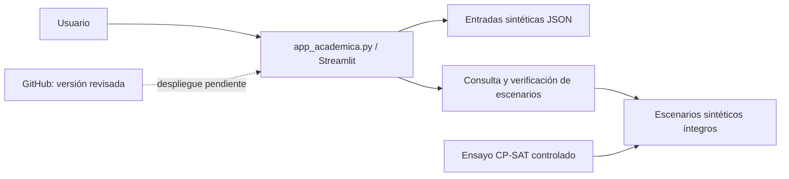

# SkyRisk Lab — Entrega 1 ABP

Demostrador académico de planificación comercial de aeronaves A320 mediante
programación con restricciones. La interfaz permite explorar entradas sintéticas
y consultar escenarios trazables sin iniciar automáticamente el optimizador.

La entrega objetivo comprende dos modalidades: **optimización interactiva de dos
trayectos mediante un botón explícito** y **consulta histórica como respaldo**.
Ambas modalidades están implementadas. El botón interactivo permanece
deshabilitado cuando la admisión no demuestra al menos 2 GiB libres; el primer
ensayo real sigue pendiente de autorización y no se ha obtenido un resultado.

El [plan de integración del botón Optimizar](docs/entrega1/plan_optimizacion_interactiva.md)
define admisión, procesos propios, límites y pruebas antes de habilitarlo.

**Estado:** preparación de la Entrega 1, con fecha límite del **16 de noviembre de
2026**. El repositorio público y el despliegue cloud están pendientes de revisión
y autorización. No hay una URL pública verificada todavía.

El proyecto profesional SkyRisk Lab V5.2 se conserva en su organización actual.
La entrada académica es `app_academica.py`; no utilice `app.py` para esta demo,
porque la aplicación profesional contiene inicializaciones y acciones operacionales.

## Problema y alcance

Asignar vuelos a una flota limitada exige conservar matrícula, ubicación y
disponibilidad, evitar solapamientos y respetar mantenimiento y tránsito. Una
asignación aislada puede dejar a una aeronave en un aeropuerto incompatible con
su siguiente compromiso. SkyRisk Lab modela estas dependencias y conserva la
evidencia individual de las decisiones.

La configuración profesional contempla 47 aeronaves regulares y tres reservas
exclusivas para contingencias. La demo utiliza únicamente datos sintéticos y
separa expresamente las entradas, los resultados observados y las pruebas.

- Escenario académico inicial: dos trayectos nacionales del 9 de noviembre de
  2026, BOG–MDE y MDE–BOG, con 60 minutos de tránsito entre ambos.
- Se conservan 50 matrículas sintéticas: 47 regulares elegibles y tres reservas
  excluidas de la programación rutinaria.
- Las entradas no equivalen a vuelos asignados. Mientras no exista una ejecución
  validada, la interfaz muestra **SIN_EJECUCION** y no presenta cobertura obtenida.
- No se ejecutan los 966 trayectos semanales ni se integra tripulación.

## Papel de la inteligencia artificial

El motor profesional utiliza OR-Tools CP-SAT para seleccionar asignaciones
mediante variables binarias y restricciones. Su objetivo actual maximiza el número
de trayectos seleccionados. La continuidad física, el tránsito mínimo, el
mantenimiento, los compromisos protegidos y las reglas internacionales limitan
las soluciones admisibles.

Este trabajo se presenta como optimización y búsqueda con restricciones. No se ha
entrenado un modelo predictivo. CP-SAT distingue `OPTIMAL`, `FEASIBLE`,
`INFEASIBLE`, `MODEL_INVALID` y `UNKNOWN`; agotar tiempo no demuestra inviabilidad.
La optimalidad de una ventana tampoco demuestra optimalidad global de una semana.
Véase la [documentación oficial de CP-SAT](https://developers.google.com/optimization/cp/cp_solver).

La consulta no carga OR-Tools. La modalidad interactiva ejecuta un modelo académico
aislado en otro proceso únicamente tras acción explícita, confirmación del alcance
y admisión de recursos; después recupera el resultado en un segundo proceso.

## Arquitectura



La implementación profesional y el visor académico comparten el formato de
trazabilidad. `academico/escenarios.py` concentra la lectura y validación del
paquete académico; la interfaz utiliza navegación explícita para no exponer las
páginas profesionales. El visor no conecta SQLite operacional ni modifica históricos.
La arquitectura cloud, la separación de componentes y el estado real de cada
elemento se describen en [arquitectura.md](docs/entrega1/arquitectura.md).

## Instalación académica local

Se requiere Python **3.14** y un entorno virtual dedicado. Estos comandos describen
la instalación académica; no instalan el entorno profesional completo.

Windows PowerShell:

```powershell
py -3.14 -m venv .venv
.\.venv\Scripts\python.exe -m pip install -r requirements.txt
.\.venv\Scripts\python.exe -m streamlit run app_academica.py
```

Linux:

```bash
python3.14 -m venv .venv
.venv/bin/python -m pip install -r requirements.txt
.venv/bin/python -m streamlit run app_academica.py
```

`requirements.txt` prepara cuatro versiones directas: Streamlit 1.66.1,
pandas 3.0.0, OR-Tools 9.15.6755 y psutil 7.2.2. La presencia de OR-Tools y psutil
no activa el solver al abrir la app. No se incluye
`sqlite3`: forma parte de Python y la aplicación académica no utiliza una base
operacional. Se verificó en los metadatos de distribución que Streamlit 1.66.1
admite Python >=3.11 y pandas 3.0.0 dispone de wheel CPython 3.14 para Linux x86_64.
Esto es una comprobación de compatibilidad declarada, no una instalación Linux
ejecutada. Las dependencias transitivas no están bloqueadas mediante un lockfile.
La prueba real de instalación y arranque en Linux debe quedar registrada antes de
declarar verificado el despliegue.

### Git para preparar el repositorio

Git for Windows 2.56.1 está instalado y disponible en la terminal local.
Con autorización, inicializar con `git init -b main`, comprobar las exclusiones
y simular el agregado de los nombres exactos de `PERMITIDOS`, definidos en el
auditor de publicación. Preparar el índice exclusivamente con esos 24 nombres;
no usar `git add .` ni `git add -A`. Después auditar el índice:

```powershell
git --version
git status --short
py -3.14 -B herramientas/validadores/auditar_paquete_academico.py --raiz . --indice
git diff --cached --name-status
git diff --cached --stat
git diff --cached --check
```

El índice debe contener exactamente los 24 archivos autorizados, sin faltantes,
extras ni diferencias de contenido respecto de los archivos locales auditados.
No ejecutar `commit` sin revisión y autorización; `push`, publicación y despliegue
requieren autorización adicional. `.gitignore` no retira archivos ya versionados.

## Cómo demostrarlo

1. Abra `app_academica.py` con Streamlit.
2. Revise el alcance sintético, los dos IDs, las rutas y los horarios de entrada.
3. Explore los filtros disponibles. Los datos de entrada no son resultados del solver.
4. En Optimización, revise la admisión. El botón solo se habilita con recursos
   suficientes y el solver solo comienza después de confirmación y pulsación.
5. Consulte únicamente escenarios sintéticos íntegros incorporados al paquete de
   demostración revisado. Si no existen, conserve el mensaje SIN_EJECUCION.
6. Cuando haya un resultado validado, muestre su `run_id`, asignaciones, perfil,
   diagnósticos e integridad. La consulta no vuelve a optimizar.

No use el botón semanal de la aplicación profesional como sustituto del ejemplo
pequeño: el filtro de jornada no reduce el tamaño de esa optimización.

## Producción de evidencia CP-SAT: implementada, pendiente del primer ensayo

En el entorno profesional local existe un arnés del paso 1 que prepara SQLite
temporal real, dos trayectos, un máximo de 94 candidatos y recuperación desde
otro proceso. Esa herramienta no forma parte del paquete cloud de consulta;
no se ofrecen comandos del entorno profesional como instrucciones ejecutables
del repositorio público.

El ensayo exige al menos **2 GiB de RAM libre**, configuración presentada y
activación explícita. Sus límites supervisados son 30 segundos de solver,
60 segundos para el productor, 15 segundos para el recuperador y 90 segundos
para el conjunto. No se ha ejecutado por falta de RAM en el equipo revisado.
La versión actual ofrece un botón explícito y un modelo académico autónomo que no
importa el planificador productivo ni SQLite. Utiliza procesos productor y
recuperador, almacén temporal, supervisión y cancelación cooperativa. La admisión
de al menos 2 GiB no se reducirá para ejecutar en cloud. Allí debe comprobarse
la memoria efectiva asignada al contenedor, además de la RAM informada por el host.

## Validación y evidencia disponible

| Evidencia | Estado verificable |
| --- | --- |
| Suite profesional previa | 112 pruebas aprobadas y aceptadas en la etapa anterior; no reejecutadas en esta preparación |
| Guardas adicionales del paso 1 | 12 casos preparados, pendientes de ejecución |
| SQLite real temporal → CP-SAT → proceso recuperador | Preparado; todavía sin resultado observado |
| Optimización interactiva desde Streamlit | Implementada y probada con proceso simulado; primer CP-SAT real no ejecutado |
| Resultado individual de la corrida histórica 896/966 | No recuperado; no se utiliza como evidencia reproducible |
| Arranque público y enlace cloud | Pendientes de publicación, despliegue y comprobación |

La auditoría profesional y sus limitaciones históricas se conservan localmente,
fuera del paquete público. Las pruebas del visor deben registrarse por separado
al verificarse; no se suman pruebas preparadas a las aprobadas. Este documento
no certifica V5.2 ni cobertura semanal. Las comprobaciones académicas se organizan en
los cuatro archivos `tests/test_*academica.py`; su resultado
efectivo se documenta en [validacion.md](docs/entrega1/validacion.md).

## Despliegue previsto en Streamlit Community Cloud

El despliegue real es un requisito de la entrega y todavía está pendiente.

1. Revisar el listado exacto de archivos publicables y sus contenidos.
2. Publicar el repositorio aprobado en GitHub; registrar URL y commit de entrega.
3. Crear la aplicación en Community Cloud con `app_academica.py` como entrada.
4. Comprobar si Advanced settings ofrece Python 3.14; solo entonces seleccionarlo
   y verificar la instalación de `requirements.txt` en los logs. La disponibilidad
   real de esa opción todavía no está verificada. Si no está disponible, detener
   el despliegue y evaluar un proveedor cloud que permita Python 3.14, conservando
   la versión profesional.
5. Comprobar desde una sesión nueva que el arranque y la consulta muestran solo
   datos sintéticos y no ejecutan CP-SAT ni conectan SQLite. Cuando la modalidad
   interactiva ya implementada sea autorizada para su primer ensayo, verificar por separado su botón,
   admisión de recursos, almacén temporal y resultado; no declarar completas ambas
   modalidades antes de esa prueba.
6. Registrar URL, commit, fecha UTC, versiones, captura y resultado de la prueba
   de arranque. Verificar de nuevo el enlace antes de entregar.

Community Cloud ejecuta aplicaciones en Linux y utiliza el repositorio como
fuente. La organización de dependencias se basa en la
[documentación oficial de despliegue](https://docs.streamlit.io/deploy/streamlit-community-cloud/deploy-your-app/app-dependencies).
La compatibilidad de paquetes o la presencia de un diagrama no sustituyen esa
prueba de despliegue real.

## Organización y publicación segura

```text
app_academica.py                  Entrada académica independiente
academico/                      Lectura y validación del paquete académico
requirements.txt                Dependencias académicas; CP-SAT conectado solo al botón explícito
demo/                           Entradas y futuros escenarios sintéticos revisados
docs/entrega1/                   Arquitectura, investigación y presentación
planificacion_comercial/         Módulos existentes; publicar solo los aprobados
tests/                          Pruebas existentes y académicas
herramientas/                   Validadores y utilidades existentes
app.py, pages/, operacion/       Proyecto profesional conservado
backups/, archivo_historico/     Conservados localmente
```

La publicación se prepara mediante una lista explícita de inclusión. `.gitignore`
complementa esa lista; no elimina archivos ya versionados ni demuestra por sí solo
que un repositorio es seguro. No publicar la SQLite operacional, sus sidecars,
históricos locales, datos de personas, credenciales, respaldos, registros privados
o la conversación HTML guardada. Excluirlos de Git conserva sus archivos locales.
Los escenarios de demostración deben mantener sus hashes; no editar un run
publicado para eliminar metadatos.
La revisión del paquete se prepara en
`herramientas/validadores/auditar_paquete_academico.py`; sus resultados deben
revisarse antes de cualquier publicación.

## Entrega y rúbrica

| Criterio oficial | Peso | Evidencia prevista |
| --- | ---: | --- |
| Problema y justificación tecnológica | 20 % | Problema operacional, alcance y selección de CP-SAT |
| Arquitectura y buenas prácticas | 25 % | Componentes, aislamiento, dependencias y despliegue real |
| Repositorio GitHub | 20 % | Código revisado, README, pruebas y versión identificable |
| Presentación | 15 % | Guion, demostración y evidencias verificables |
| Rigor técnico e investigación | 20 % | Fuentes, métricas, hipótesis y límites de los resultados |

Material de apoyo: [arquitectura](docs/entrega1/arquitectura.md),
[investigación](docs/entrega1/investigacion.md) y
[estructura de presentación](docs/entrega1/presentacion.md).

Después de la entrega se retomarán cobertura semanal, calibración del perfil
experimental, escalabilidad, operación cloud profesional y tripulaciones con
autorización específica.
