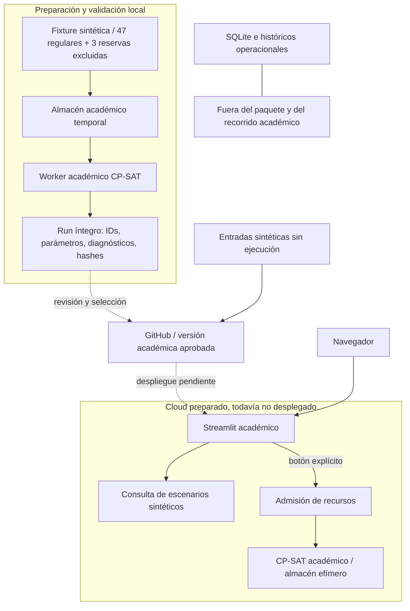

# Arquitectura de la entrega académica

## Estado y objetivo

La entrega utiliza una aplicación Streamlit independiente para explorar entradas
sintéticas y consultar escenarios verificados. La publicación de GitHub y el
despliegue en Streamlit Community Cloud están pendientes de aprobación y prueba
real. No existe todavía una URL pública verificada.

Se conserva la estructura profesional de SkyRisk Lab V5.2. `app.py`, SQLite
operacional, mantenimiento, motores comerciales y tripulaciones no se modifican
para crear este visor. No se ejecuta automáticamente CP-SAT al cargar la app.

La entrega objetivo tendrá dos modalidades: optimización interactiva del caso de
dos trayectos, mediante botón explícito, y consulta histórica como respaldo.
Ambas rutas están implementadas. La interacción y conservación del histórico se
probaron con procesos simulados; el primer CP-SAT real continúa sin ejecutarse.

## Componentes y responsabilidades

| Componente | Responsabilidad | Acceso a datos |
| --- | --- | --- |
| `app_academica.py` | Presentar alcance, entradas y resultados disponibles | Lectura de datos académicos aprobados |
| `academico/escenarios.py` | Validar procedencia y límites del paquete académico | Solo lectura, sin imports del motor ni de SQLite |
| `academico/ejecucion.py` | Admitir recursos, supervisar productor/recuperador y comparar hashes | Temporales propios; no usa históricos profesionales |
| `academico/worker.py` | Construir el modelo académico CP-SAT de 94 variables y recuperar su run | OR-Tools solo en productor; sin SQLite ni módulos productivos |
| `demo/entradas_paso1.json` | Describir dos vuelos y flota sintéticos | Archivo de entrada, sin asignaciones inventadas |
| `AlmacenEscenarios` | Consultar, recuperar y verificar hashes y cierres | Solo los escenarios sintéticos del paquete académico |
| Ensayo controlado del paso 1 | Producir evidencia usando el motor existente | SQLite y almacén temporales independientes |
| GitHub | Versionar el contenido revisado de la entrega | Lista explícita de archivos publicables |
| Community Cloud | Servir el visor desde el commit aprobado | Sin acceso a SQLite operacional ni históricos profesionales |
| Modalidad interactiva | Solicitar el ensayo pequeño mediante acción explícita | Dos procesos, modelo y almacén académico temporales |

Las líneas de despliegue representan trabajo pendiente. El diagrama no acredita
que una aplicación esté publicada.

El 13 de noviembre de 2026 se ejecutó satisfactoriamente el motor académico
CP-SAT en Google Colab, utilizando Python 3.13.18 y OR-Tools 9.15.6755.

El escenario sintético de dos trayectos obtuvo una solución OPTIMAL,
con objetivo 2/2, 94 variables, 49 restricciones y una secuencia
BOG-MDE-BOG asignada a la aeronave HK-049.

La evidencia verificable se conserva en
`docs/evidencias/evidencia_cpsat_publica.json`.

Esta ejecución valida el motor académico para el escenario ensayado,
pero no demuestra todavía el funcionamiento de la aplicación Streamlit
en un entorno cloud público ni la optimización de la operación semanal.

La ruta interactiva aplica el plan aprobado de aislamiento, supervisión y recuperación.
No podrá escribir en el historial publicado ni utilizar datos operacionales. El
umbral de 2 GiB de RAM libre se mantiene y debe contrastarse con el límite efectivo
del contenedor cloud, no solamente con la memoria total o disponible del host.

## Flujo de datos

1. La app carga el catálogo sintético aprobado y presenta su procedencia.
2. Si no hay escenarios comerciales validados, muestra SIN_EJECUCION. No deriva
   resultados de un horario esperado ni de un resumen agregado anterior.
3. Los escenarios que se incorporen deberán tener identidad `run_id`, tipo de
   datos SINTETICO y cadena de integridad válida.
4. La recuperación comprueba manifiestos, tamaños, hashes, secuencia y cierre.
   Un checkpoint sin cierre completo se distingue de un resultado publicable.
5. La app presenta asignaciones y diagnósticos sin volver a resolver el modelo.

El almacén profesional persiste eventos completos mediante staging, creación
exclusiva, `flush`, `fsync`, lectura de verificación y renombrado dentro del mismo
volumen. La consulta no ejecuta código archivado. Las pruebas de fallos de
aplicación no constituyen certificación frente a un corte eléctrico.

## Motor y reglas conservadas

CP-SAT pertenece al flujo productor separado. El caso académico utiliza 94
variables binarias y maximiza los dos trayectos sujeto a unicidad y continuidad
física BOG–MDE–BOG, con tránsito de 60 minutos. Solo crea candidatos para 47
regulares. No prueba mantenimiento o reglas internacionales, que pertenecen al
modelo profesional y a sus pruebas previas.

Las rutas BOG–MIA, MDE–MIA, MDE–PTY y MDE–SDQ admiten entre 60 y 120 minutos
**totales** en tierra en el extranjero y no permiten pernocta comercial programada.
El mínimo de tránsito está incluido dentro del máximo. La demo nacional inicial
no prueba esas rutas: la evidencia correspondiente procede de las pruebas
internacionales ya aprobadas.

ORIGINAL conserva cuatro trabajadores, presolve deshabilitado y el límite de
reloj configurado. EXPERIMENTAL_REPRODUCIBLE conserva sus parámetros provisionales:
un trabajador, semilla 1, diez unidades deterministas y guardia de 300 segundos.
El visor puede mostrar configuraciones archivadas, pero no ejecuta ni calibra
perfiles. No se afirma reproducibilidad estricta.

## Seguridad y separación de entornos

- El punto de entrada académico no importa `app.py` ni necesita inicializar la
  base operacional. La navegación registra explícitamente las páginas académicas;
  no incorpora automáticamente el directorio profesional `pages/`.
- No se distribuyen bases operacionales, historiales de personas, respaldos,
  credenciales ni archivos de conversación privados.
- Los datos sintéticos conservan una declaración visible de procedencia. Las
  entradas, fixtures de pruebas y resultados observados se diferencian.
- Los runs conservan identidad y hashes. Una nueva ejecución no sustituye un run
  anterior; un error de integridad impide presentarlo como válido.
- Las dependencias del visor se declaran en un único `requirements.txt` con
  versiones fijadas. Los paquetes del solver no se cargan para consultar.
- El paquete público se verifica antes de publicar; `.gitignore` no sustituye la
  inspección del contenido ni elimina secretos previamente versionados.

En la arquitectura académica no se introducen usuarios, roles operacionales ni
escrituras de mantenimiento. Un despliegue profesional multiusuario requerirá
autenticación, autorización, almacenamiento durable privado, control de
concurrencia y supervisión que quedan fuera de esta entrega.

## Compatibilidad y despliegue verificable

La plataforma local de referencia es Python 3.14. El objetivo cloud es Linux en
Streamlit Community Cloud. Declarar dependencias compatibles no equivale a haber
probado el despliegue. Deben comprobarse instalación, arranque y navegación en la
plataforma real, conservando los logs y el commit asociado.

Los metadatos primarios de [Streamlit 1.66.1](https://pypi.org/project/streamlit/1.66.1/)
declaran Python >=3.11; el [índice oficial de pandas](https://pypi.org/simple/pandas/)
incluye un wheel pandas 3.0.0 para CPython 3.14 y Linux x86_64. Las versiones
directas propuestas son compatibles por sus rangos declarados. Las transitivas
siguen sujetas a resolución: `requirements.txt` no constituye un lockfile completo.

La documentación de Community Cloud describe un selector de Python, pero esta
preparación no ha verificado que Python 3.14 esté disponible en la cuenta de
despliegue. Si no lo está, se evaluará otro proveedor cloud que permita esa versión;
no se cambiará silenciosamente el entorno profesional.

Antes de publicar se registrarán:

| Evidencia | Estado actual |
| --- | --- |
| Repositorio y commit público | Pendiente |
| URL de la app | Pendiente |
| Versión real de Python y paquetes en Linux | Pendiente de verificación ejecutada |
| Arranque desde sesión nueva | Pendiente |
| Procedencia sintética y ausencia de acceso operacional | Debe comprobarse en el ensayo de interfaz |
| Integridad y consulta sin optimizador | Pruebas previas existentes; repetir sobre el paquete académico |
| Ejecución académica de CP-SAT en Linux (Google Colab) | Validada con Python 3.13.18 y OR-Tools 9.15.6755; resultado OPTIMAL, 2/2 trayectos y evidencia pública disponible |

Los resultados de los tests del visor y de la auditoría de publicación deben
consultarse en [validacion.md](validacion.md). Un fixture de test no se incorpora
al paquete como si fuera un resultado observado de CP-SAT.

La ejecución CP-SAT exige al menos 2 GiB de RAM libre y presupuestos supervisados.
El visor de consulta no garantiza recursos para una optimización semanal y no
ofrece ese recorrido. El almacenamiento cloud del paquete académico sirve para
consultar artefactos revisados; no se presenta como almacén operacional durable.

## Referencias

- [CP-SAT: modelos, estados y resolución](https://developers.google.com/optimization/cp/cp_solver).
- [Dependencias y entorno Linux de Community Cloud](https://docs.streamlit.io/deploy/streamlit-community-cloud/deploy-your-app/app-dependencies).
- [Administración y recursos de Community Cloud](https://docs.streamlit.io/deploy/streamlit-community-cloud/manage-your-app).
- [Validación pública y límites de la evidencia](validacion.md). La auditoría
  profesional histórica se conserva localmente y no se publica.
